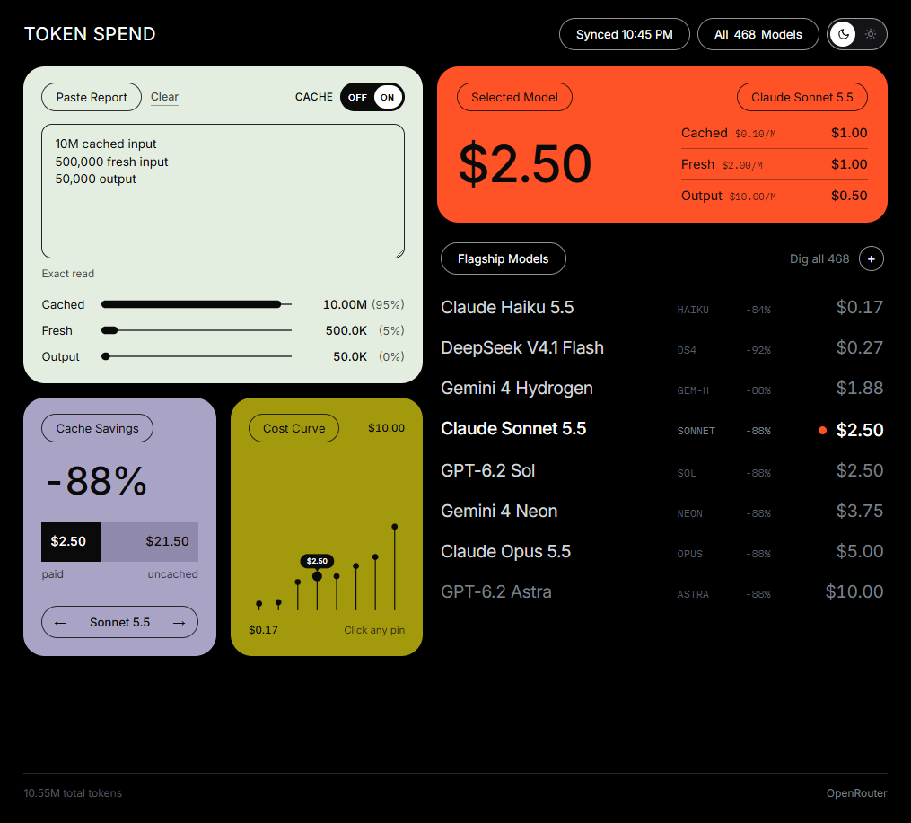
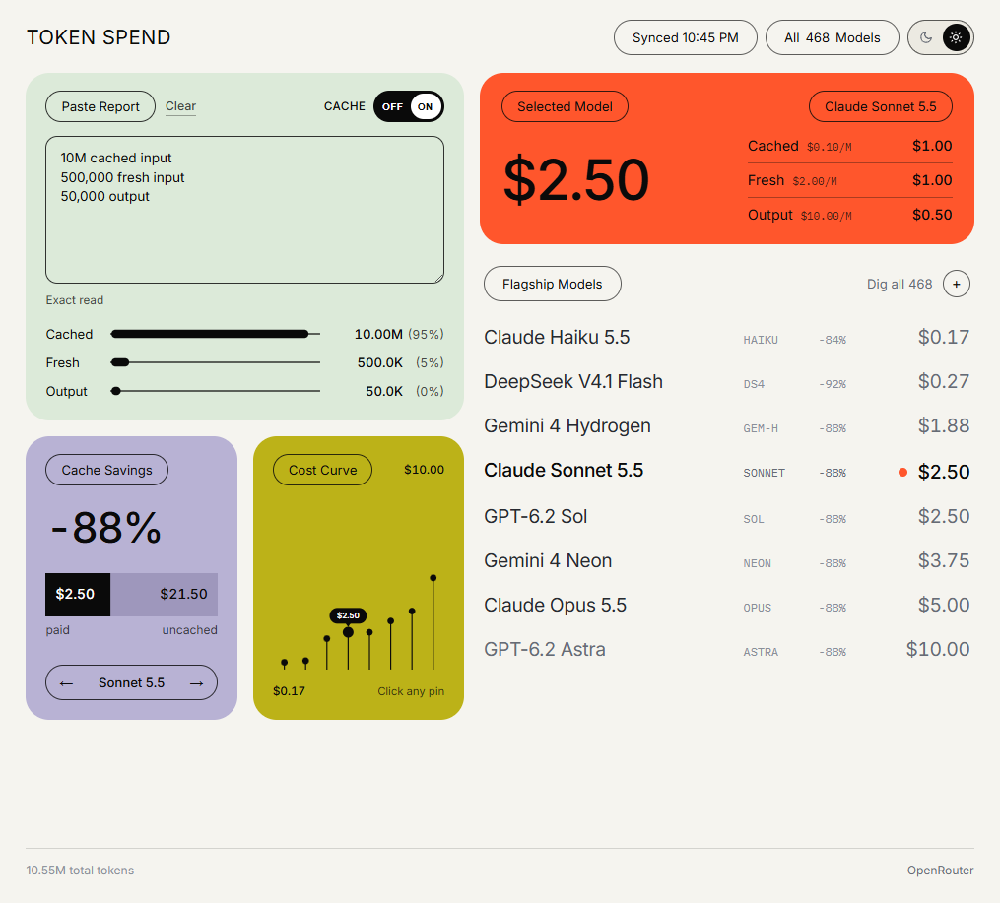

<div align="center">

<br />

# TOKEN SPEND

**Your AI agent just burned 50M tokens. Was that $3 or $110?**

Paste messy agent reports, chat summaries, Markdown tables, or raw API JSON — see the exact bill across **460+ live models** in one second.

<br />

[](https://techcamper19.github.io/tokencounter/)
&nbsp;
[](https://openrouter.ai/models)
&nbsp;
[](#run-locally-or-fork)

<br />

<a href="https://techcamper19.github.io/tokencounter/">
  <picture>
    <source media="(prefers-color-scheme: dark)" srcset="assets/preview-dark.png" />
    <source media="(prefers-color-scheme: light)" srcset="assets/preview-light.png" />
    
  </picture>
</a>

<br />

*No backend. No API key. No build step. 100% client-side.*

</div>

---

## Why This Exists

Modern coding agents routinely burn **10M–100M tokens** in a single session — and **85%–95% of it is cached context**.

- Standard token calculators ignore prompt caching and make a **$3.00** run look like **$31.00**.
- Hardcoded pricing tables go stale every time a new flagship drops.
- Nobody wants to copy-paste token logs into a spreadsheet just to sanity-check an agent run.

**Token Spend** lets you drop raw usage text straight into one box, pulls **live per-token and cache-read rates** directly from OpenRouter, and shows what the exact same run costs across flagship models — plus all **460+ models** one click away.

---

## How to Use

1. **Open the app:** [techcamper19.github.io/tokencounter](https://techcamper19.github.io/tokencounter/)
2. **Paste your token log** into the pale-mint **Paste Report** box — prose, bullet points, tables, shorthand, or raw JSON.
3. **Compare & inspect instantly:**
   - **Flip `CACHE OFF / ON`** to see the real dollar impact of prompt caching.
   - **Click any pin** on the olive **Cost Curve** (or any model row) to switch the active flagship breakdown.
   - **Click any number** beside the bars (`Cached`, `Fresh`, `Output`) to fine-tune manually.
   - **Click `Dig all 460+`** to search and pin any other model on OpenRouter to your main list.

---

## Paste Literally Anything (Zero Guessing)

The built-in parser understands how real tools and chats actually report tokens — and **never silently guesses** when numbers are ambiguous.

| Format | Example Paste | What Token Spend Does |
| :--- | :--- | :--- |
| **Conversational prose** | `5.65 million (85%) were cached input... 884,000 were fresh input, and 76,000 were generated output.` | Extracts exact `5.65M` cached, `884K` fresh, `76K` output |
| **Agent / session bullets** | `14.50M cached input`<br>`674,508 fresh input`<br>`65,648 output, including reasoning` | Parses cleanly without double-counting reasoning |
| **OpenAI / OpenRouter JSON** | `{"usage":{"prompt_tokens":100000,"completion_tokens":2500,"prompt_tokens_details":{"cached_tokens":80000}}}` | Subtracts `cached_tokens` from `prompt_tokens` automatically (`20K` fresh) |
| **Anthropic JSON** | `{"input_tokens":12000,"cache_read_input_tokens":90000,"output_tokens":3400}` | Keeps `input_tokens` as fresh uncached input (no double-subtraction) |
| **Gemini `usageMetadata`** | `{"promptTokenCount":50000,"cachedContentTokenCount":40000,"candidatesTokenCount":1200,"thoughtsTokenCount":800}` | Sums candidates + thinking into output, subtracts cached prompt |
| **Multi-agent logs / JSONL** | Multiple lines or JSON blocks across worker runs | Automatically sums every agent's cached, fresh, and output tokens |
| **Markdown tables** | `\| Cached input \| 14.50M \|` | Strips table syntax and reads every row cleanly |
| **Unsplit input + output** | `4.13M input and output tokens... 50.65M cached` | **Flags it honestly**, shows the exact **min–max cost range**, and gives 1-click split chips (`All in`, `90/10`, `80/20`, `70/30`) |

---

## Dark & Light Mode

Switch anytime with the tactile **Moon / Sun** toggle in the top-right corner (persisted in `localStorage`).

<table>
  <tr>
    <td width="50%" align="center">
      
      <br /><sub><b>Dark Mode</b> — pitch-black neo-Swiss bento</sub>
    </td>
    <td width="50%" align="center">
      
      <br /><sub><b>Light Mode</b> — warm gallery paper</sub>
    </td>
  </tr>
</table>

---

## Highlights

- **Live OpenRouter Pricing:** Fetches `https://openrouter.ai/api/v1/models` directly in the browser and caches locally for 30 minutes (click **Live OpenRouter** anytime to force-refresh).
- **Transparent Unit Math:** Displays the exact per-1M rates (`$0.10/M`, `$2.00/M`, `$10.00/M`) right beside each line item so you can verify every cent.
- **Interactive SVG Cost Curve:** Clickable pin-stem chart visualizing the spread from budget flash models to frontier reasoning models.
- **Privacy by Design:** Zero telemetry, zero cookies, zero servers — everything you paste stays strictly in your browser tab.

---

## Run Locally or Fork

The entire app is **3 static files** (`index.html`, `style.css`, `app.js`) with zero dependencies and zero build step.

```bash
git clone https://github.com/techcamper19/tokencounter.git
cd tokencounter
```

Open `index.html` directly in your browser — or run any local static server:

```bash
python -m http.server 8765
```

Deploy your own fork in 10 seconds with **GitHub Pages** (branch `main`, folder `/`) or **Vercel** (zero config).

---

<div align="center">

If this saved you from doing mental math on a 40M-token agent run, drop a **star** on the repo.

</div>
